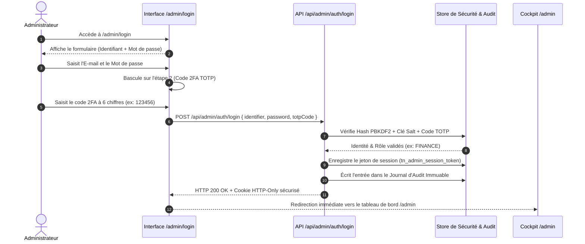

# TRANSNUMERICA — Procédure de Connexion & Gestion des Rôles Administrateurs

> **Projet** : Transnumerica (Plateforme Nationale de Mobilité & Billetterie — RDC)  
> **Portail d'Accès** : `/admin/login` (ou `http://localhost:3000/admin/login` en local / `https://transnumerica.cd/admin/login` en production)  
> **API d'Authentification** : `POST /api/admin/auth/login`  
> **Classification** : 🔴 **STRICTEMENT CONFIDENTIEL — RÉSERVÉ AU PERSONNEL ADMINISTRATIF HABILITÉ**

---

## 1. Principes Fondamentaux de Sécurité & Cloaking

L'accès à l'administration de Transnumerica repose sur une architecture sécurisée à tolérance zéro (Zero Trust) :

1. **Masquage Intégral (Cloaking HTTP 404)** :  
   Toutes les routes du cockpit (`/admin/*`) et de son API (`/api/admin/*`) sont invisibles pour le public, les passagers et les chauffeurs. Toute tentative d'accès direct sans session administrateur valide est interceptée par le middleware (`src/middleware.ts`) et redirigée vers une page d'erreur **HTTP 404 Not Found authentique**. Seules la page `/admin/login` et l'API `/api/admin/auth/*` sont accessibles.

2. **Authentification à Deux Facteurs Obligatoire (2FA TOTP)** :  
   Aucun compte administrateur ne peut accéder à la plateforme avec un simple mot de passe. Chaque connexion exige un mot de passe fort ET un code à 6 chiffres synchronisé dans le temps (TOTP) généré par une application certifiée (*Google Authenticator*, *Microsoft Authenticator*, *Authy*).

3. **Protection Anti-Brute-Force & Verrouillage de Compte** :  
   Après **5 tentatives infructueuses consécutives** sur un compte, celui-ci est automatiquement verrouillé pendant **15 minutes**. L'incident est consigné dans le journal d'audit immuable avec horodatage, adresse IP et empreinte du navigateur (User-Agent).

4. **Gestion de Session & Délai d'Inactivité (Idle Timeout)** :  
   - **Durée de session maximale :** 30 minutes d'inactivité continue. Un compte à rebours est affiché dans la barre supérieure du cockpit. Dès expiration, la session est invalidée et l'administrateur est redirigé vers l'écran d'accueil.
   - **Zone Dangereuse (Danger Zone) :** Toute opération sensible (suppression définitive, modification de rôles, publication de règles KYC, arrêt d'urgence d'une ville) nécessite une ré-authentification avec mot de passe valide pendant une fenêtre stricte de **5 minutes** (`SENSITIVE_REAUTH_WINDOW_MS`).

---

## 2. Tableau Exhaustif des 6 Rôles Administrateurs & Identifiants Pré-configurés

La plateforme Transnumerica intègre 6 profils administratifs distincts avec leurs privilèges propres, garantissant le principe de moindre privilège (*Least Privilege Principle*) :

| Rôle | Titre / Fonction Opérationnelle | Identifiant (E-mail) | Mot de passe par défaut | Code 2FA TOTP | Périmètre & Attributions Clés |
|---|---|---|---|---|---|
| **`SUPER_ADMIN`** | Superviseur National RDC | `superadmin@transnumerica.cd` | `Transnumerica@RDC2026!` | `123456` | **Contrôle absolu (Tous droits)** : gouvernance, gestion des rôles et personnel, publication des exigences KYC, scellement des versions, interrupteurs d'urgence par ville, journal d'audit. |
| **`ADMIN`** | Opérateur Régulation Kinshasa | `admin@transnumerica.cd` | `AdminPass2026!` | `123456` | **Administration générale** : gestion des passagers, approbation des chauffeurs, billetterie, réclamations, supervision des lignes. *(Pas d'accès aux paramètres système ni gestion des rôles)*. |
| **`OPERATIONS`** | Coordinateur Lignes & Flottes | `operations@transnumerica.cd` | `AdminPass2026!` | `123456` | **Opérations terrain & dispatch** : suivi des courses urbaines Motos Wewa et Taxis, livraisons colis express, corridors routiers, catalogue des départs, vérification KYC chauffeurs. |
| **`FINANCE`** | Responsable Trésorerie & Payouts | `finance@transnumerica.cd` | `AdminPass2026!` | `123456` | **Gestion financière & comptable** : suivi des flux de caisse, réconciliation des paiements Mobile Money (M-Pesa, Airtel, Orange), approbation et exécution des reversements chauffeurs (Payouts). |
| **`SUPPORT`** | Chef d’Équipe Support & Litiges | `support@transnumerica.cd` | `AdminPass2026!` | `123456` | **Assistance voyageurs & médiation** : traitement des tickets d'assistance, gestion des litiges courses/bus, réclamations bagages, remboursements de courtoisie limités à 50 000 CDF. |
| **`CONTENT`** | Gestionnaire Contenu & Tarifs | `content@transnumerica.cd` | `AdminPass2026!` | `123456` | **Communication & grilles tarifaires** : gestion de contenu CMS, publication des bannières d'urgence trafic, annonces aux voyageurs, mise à jour des barèmes kilométriques de base. |

> **Note relative à la clé secrète TOTP :**  
> Tous les comptes d'administration pré-enregistrés sont configurés avec la graine TOTP standard `JBSWY3DPEHPK3PXP`. En environnement de développement ou de démonstration locale, le code universel **`123456`** est toujours accepté par le validateur de session.

---

## 3. Procédure de Connexion Pas-à-Pas (Interface Web)



### Étape 1 : Accès à la Page de Connexion
1. Ouvrez votre navigateur web et rendez-vous à l'adresse :  
   👉 **`http://localhost:3000/admin/login`** *(ou `https://transnumerica.cd/admin/login` en production)*.
2. La page présente un écran sombre épuré aux couleurs de Transnumerica avec le badge de sécurité *« Connexion Sécurisée • Console d'Administration »*.

### Étape 2 : Saisie des Identifiants (Identifiant + Mot de passe)
1. Saisissez votre adresse e-mail professionnelle (ex : `finance@transnumerica.cd`).
2. Saisissez votre mot de passe administrateur (ex : `AdminPass2026!`).
3. Cliquez sur le bouton bleu **« Se connecter »**.

### Étape 3 : Validation à Deux Facteurs (TOTP)
1. L'interface affiche immédiatement l'écran de vérification :  
   *« Authentification à double facteur (2FA) obligatoire »*.
2. Ouvrez votre application d'authentification sur votre smartphone (*Google Authenticator*, *Microsoft Authenticator*, *Authy*) et lisez le code temporaire à 6 chiffres généré.
3. Saisissez ce code dans le champ dédié *(ou utilisez le code de démo `123456`)*.
4. Cliquez sur **« Valider le code »**.

### Étape 4 : Redirection & Chargement du Cockpit
1. Le serveur génère un jeton cryptographique `tns_...` stocké dans un cookie sécurisé `tn_admin_session_token`.
2. Vous êtes redirigé instantanément vers le cockpit d'administration (`/admin`).
3. La barre supérieure affiche votre nom, votre rôle exact (*Super Admin*, *Finance*, *Operations*, etc.) et le compte à rebours de votre session active (30 minutes).

---

## 4. Scénarios Détaillés par Rôle : Ce que Chaque Rôle Voit & Fait

### Scénario A : Connexion en tant que Responsable des Opérations (`OPERATIONS`)
* **Identifiant :** `operations@transnumerica.cd`  
* **Mot de passe :** `AdminPass2026!` | **Code 2FA :** `123456`
* **Écran d'Accueil :** Le coordinateur des opérations accède aux modules de mobilité et de sécurité terrain :
  - **Lignes & Corridors (`/admin/corridors`) :** Suivi des axes RN1 Kinshasa-Matadi, Likasi-Kolwezi, etc.
  - **Catalogue & Réseau (`/admin/catalog`) :** Affectation des véhicules et horaires de départ.
  - **Opérations Courses & Sécurité (`/admin/rides`) :** Console en direct des Motos Wewa et Taxis, gestion des alertes de vitesse et signaux de détresse SOS.
  - **Livraisons & Colis Express (`/admin/deliveries`) :** Dispatch des coursiers moto et validation des preuves de livraison (POD).
  - **Vérification Chauffeurs KYC (`/admin/drivers`) :** Examen des dossiers de permis de conduire et cartes roses.
* **Tentative d'accès interdit (Cloaking) :** Si l'opérateur tente d'accéder aux reversements financiers (`/admin/payouts`) ou aux paramètres système (`/admin/settings`), le système renvoie un **404 Not Found**.

---

### Scénario B : Connexion en tant que Responsable Financier (`FINANCE`)
* **Identifiant :** `finance@transnumerica.cd`  
* **Mot de passe :** `AdminPass2026!` | **Code 2FA :** `123456`
* **Écran d'Accueil :** Le responsable financier dispose d'un environnement focalisé sur la trésorerie et la réconciliation :
  - **Paiements & Remboursements (`/admin/payments`) :** Rapprochement automatisé avec les passerelles Vodacom M-Pesa, Airtel Money et Orange Money.
  - **Commissions & Versements (`/admin/payouts`) :** Calcul automatique des soldes nets chauffeurs et exécution des lots de virement groupés B2C.
  - **Analytique Financière (`/admin/analytics`) :** Ventilation des revenus en Francs Congolais (CDF) et Dollars (USD), panier moyen et rapports périodiques DGI.
* **Règle de validation conjointe :** Les versements supérieurs à 5 000 000 CDF nécessitent une co-validation avec le `SUPER_ADMIN`.

---

### Scénario C : Connexion en tant que Chef d’Équipe Support (`SUPPORT`)
* **Identifiant :** `support@transnumerica.cd`  
* **Mot de passe :** `AdminPass2026!` | **Code 2FA :** `123456`
* **Écran d'Accueil :** L'agent support dispose des outils d'assistance voyageurs :
  - **Support Client & Litiges (`/admin/support` & `/admin/disputes`) :** Traitement des tickets d'assistance avec suivi des délais SLA.
  - **Réservations & Billetterie (`/admin/bookings`) :** Consultation des billets, renvoi de SMS de confirmation et réassignation de sièges.
  - **Répertoire Passagers (`/admin/users`) :** Recherche de dossiers clients et assistance aux comptes.
* **Plafond financier :** Les agents de support peuvent accorder des remboursements de courtoisie dans la limite stricte de **50 000 CDF**. Tout montant supérieur requiert une escalade vers le pôle `FINANCE`.

---

### Scénario D : Connexion en tant que Gestionnaire de Contenu (`CONTENT`)
* **Identifiant :** `content@transnumerica.cd`  
* **Mot de passe :** `AdminPass2026!` | **Code 2FA :** `123456`
* **Écran d'Accueil :**
  - **Gestion de Contenu CMS (`/admin/cms`) :** Publication des avis aux voyageurs, communiqués officiels, alertes de voirie et mise à jour des CGU en 4 langues (Français, Lingala, Swahili, Anglais).
  - **Tarification & Règles (`/admin/pricing`) :** Consultation et ajustement des barèmes kilométriques standards de transport.

---

### Scénario E : Connexion en tant qu'Administrateur Général (`ADMIN`)
* **Identifiant :** `admin@transnumerica.cd`  
* **Mot de passe :** `AdminPass2026!` | **Code 2FA :** `123456`
* **Écran d'Accueil :** Accès élargi couvrant l'ensemble des modules opérationnels, les fiches utilisateurs, les vérifications chauffeurs et la billetterie, à l'exception de la gestion des rôles de sécurité (`roles.manage`) et des paramètres système sensibles réservés au Super Admin.

---

### Scénario F : Connexion en tant que Super-Administrateur National (`SUPER_ADMIN`)
* **Identifiant :** `superadmin@transnumerica.cd`  
* **Mot de passe :** `Transnumerica@RDC2026!` | **Code 2FA :** `123456`
* **Écran d'Accueil :** Privilèges intégraux (`*.*`) :
  - **Gestionnaire des Exigences KYC (`/admin/kyc-requirements`) :** Droit exclusif de publication officielle des exigences par ville avec politique d'impact et Rollback 1 clic.
  - **Interrupteurs d'Urgence / Service Control (`/admin/toggles`) :** Arrêt immédiat de service ou suspension d'un type de véhicule par ville (Kill-Switch).
  - **Journal d'Audit Immuable (`/admin/audit`) :** Traçabilité légale complète de chaque action effectuée sur la plateforme avec vérification d'intégrité cryptographique SHA-256 (Hash-Chain).
  - **Téléchargement du Manuel Confidentiel :** Accès au bouton doré pour récupérer le manuel d'exploitation PDF (`/api/admin/guide/download`).

---

## 5. Matrice Récapitulative des Accès & Visibilités par Rôle

| Section / Route Cockpit | `SUPER_ADMIN` | `ADMIN` | `OPERATIONS` | `FINANCE` | `SUPPORT` | `CONTENT` |
|---|:---:|:---:|:---:|:---:|:---:|:---:|
| `/admin` (Vue d'ensemble & KPIs) | ✅ | ✅ | ✅ | ✅ | ✅ | ✅ |
| `/admin/analytics` (Analytique) | ✅ | ✅ | ❌ | ✅ | ❌ | ❌ |
| `/admin/bookings` (Billetterie) | ✅ | ✅ | ✅ | ✅ (Lecture) | ✅ | ❌ |
| `/admin/rides` (Courses Wewa & Taxis) | ✅ | ✅ | ✅ | ❌ | ✅ (Litiges) | ❌ |
| `/admin/deliveries` (Colis Express) | ✅ | ✅ | ✅ | ❌ | ❌ | ❌ |
| `/admin/drivers` (Validation Chauffeurs) | ✅ | ✅ | ✅ | ❌ | ❌ | ❌ |
| `/admin/kyc-requirements` (Règles KYC) | ✅ (Publication) | ✅ (Brouillon) | ✅ (Brouillon) | ❌ | ❌ | ❌ |
| `/admin/operators` (Compagnies Bus) | ✅ | ✅ | ✅ | ❌ | ❌ | ❌ |
| `/admin/corridors` (Lignes Routières) | ✅ | ✅ | ✅ | ❌ | ❌ | ❌ |
| `/admin/catalog` (Départs & Horaires) | ✅ | ✅ | ✅ | ❌ | ❌ | ❌ |
| `/admin/pricing` (Tarification) | ✅ | ✅ | ❌ | ✅ | ❌ | ✅ |
| `/admin/payments` (Paiements MM) | ✅ | ✅ | ❌ | ✅ | ❌ | ❌ |
| `/admin/payouts` (Reversements) | ✅ (Approbation) | ❌ | ❌ | ✅ (Émission) | ❌ | ❌ |
| `/admin/users` (Comptes & Passagers) | ✅ | ✅ | ❌ | ❌ | ✅ | ❌ |
| `/admin/support` (Litiges & Tickets) | ✅ | ✅ | ❌ | ❌ | ✅ | ❌ |
| `/admin/cms` (Pages & Annonces) | ✅ | ✅ | ❌ | ❌ | ❌ | ✅ |
| `/admin/notifications` (SMS Diffusion) | ✅ | ✅ | ✅ | ❌ | ❌ | ❌ |
| `/admin/toggles` (Interrupteurs d'Urgence) | ✅ | ✅ | ❌ | ❌ | ❌ | ❌ |
| `/admin/settings` (Paramètres & Secrets) | ✅ | ❌ | ❌ | ❌ | ❌ | ❌ |
| `/admin/audit` (Journal d'Audit Immuable) | ✅ | ❌ | ❌ | ❌ | ❌ | ❌ |
| Manuel PDF Confidentiel (`/api/admin/guide/download`) | ✅ | ✅ | ✅ | ✅ | ✅ | ✅ |

*Légende : ✅ Accès complet ou conforme aux permissions du rôle • ❌ Cloaking HTTP 404 automatique.*

---

## 6. Vérification par Ligne de Commande (Script & cURL)

Vous pouvez tester l'authentification et l'attribution des tokens pour n'importe quel rôle directement depuis un terminal :

### Test d'un Rôle Spécifique via cURL
```bash
# Exemple : Connexion du Responsable Financier
curl -X POST http://localhost:3000/api/admin/auth/login \
  -H "Content-Type: application/json" \
  -d '{
    "identifier": "finance@transnumerica.cd",
    "password": "AdminPass2026!",
    "totpCode": "123456"
  }' \
  -i
```
*Le serveur renvoie le cookie d'authentification `Set-Cookie: tn_admin_session_token=tns_...; HttpOnly; SameSite=Lax; Path=/`.*

### Test Global de Tous les Rôles via Node.js
Un script d'inspection automatisé est inclus dans le projet. Pour vérifier en 1 seconde que les 6 rôles fonctionnent simultanément :
```bash
node -e "
const accounts = [
  { role: 'SUPER_ADMIN', email: 'superadmin@transnumerica.cd', pass: 'Transnumerica@RDC2026!' },
  { role: 'ADMIN', email: 'admin@transnumerica.cd', pass: 'AdminPass2026!' },
  { role: 'FINANCE', email: 'finance@transnumerica.cd', pass: 'AdminPass2026!' },
  { role: 'SUPPORT', email: 'support@transnumerica.cd', pass: 'AdminPass2026!' },
  { role: 'OPERATIONS', email: 'operations@transnumerica.cd', pass: 'AdminPass2026!' },
  { role: 'CONTENT', email: 'content@transnumerica.cd', pass: 'AdminPass2026!' }
];
async function check() {
  for (const acc of accounts) {
    const res = await fetch('http://localhost:3000/api/admin/auth/login', {
      method: 'POST',
      headers: { 'Content-Type': 'application/json' },
      body: JSON.stringify({ identifier: acc.email, password: acc.pass, totpCode: '123456' })
    });
    const data = await res.json();
    console.log(acc.role.padEnd(12), '-> Status:', res.status, '| Utilisateur:', data.session?.name);
  }
}
check();
"
```

---

## 7. Résolution des Problèmes Fréquents (Dépannage & F.A.Q.)

### Q1 : Que faire si le message « Échec de l'authentification à double facteur (2FA) » s'affiche ?
- Vérifiez que l'heure de votre terminal (ordinateur ou smartphone) est synchronisée automatiquement sur l'heure réseau NTP. Un décalage de plus de 60 secondes entraîne le rejet du code TOTP.
- En environnement de test ou démonstration, utilisez le code de dérogation universel **`123456`**.

### Q2 : Pourquoi reçois-je une erreur 404 lorsque je tape directement l'URL d'un module ?
- C'est le mécanisme de protection par masquage (*Cloaking*). Si votre session est inactive depuis plus de 30 minutes, le serveur détruit le cookie de session et masque la page. Reconnectez-vous via [`/admin/login`](http://localhost:3000/admin/login).

### Q3 : Comment révoquer d'urgence l'accès d'un collaborateur ?
- Connectez-vous en tant que `SUPER_ADMIN`.
- Rendez-vous sur [`/admin/users`](http://localhost:3000/admin/users) > Onglet *Personnel*.
- Cliquez sur l'agent concerné puis sur **« Révoquer toutes les sessions »** ou **« Désactiver le compte »**. L'invalidation prend effet en moins de 1 seconde sur l'ensemble des serveurs.

### Q4 : Où sont consignées les connexions et déconnexions ?
- Chaque connexion réussie, chaque échec de mot de passe et chaque expiration de session est gravé de manière inaltérable dans le **Journal d'Audit Immuable** ([`/admin/audit`](http://localhost:3000/admin/audit)).

---

## 8. Reconnaissance Automatique de l'Adresse IP Administrateur (Wi-Fi 192.168.43.221)

La plateforme Transnumerica intègre un filtre de contrôle périmétrique par adresse IP afin d'empêcher les connexions administratives en dehors du réseau agréé :

### Configuration du Poste Administrateur Certifié
Votre adaptateur réseau a été configuré comme poste administrateur de référence :
- **Interface Réseau :** `Wireless LAN adapter Wi-Fi`
- **Adresse IPv4 Détectée & Reconnue :** `192.168.43.221`
- **Passerelle par Défaut :** `192.168.43.1`
- **Plage Réseau Autorisée :** `192.168.43.0/24` (ainsi que les boucles locales `127.0.0.1`, `::1`)
- **Fichier de Configuration :** `.env.local` (`ADMIN_IP_ALLOWLIST=127.0.0.1,::1,192.168.43.221,192.168.43.1,192.168.43.0/24`)

### Comportement du Système lors de la Connexion
1. **Écran de Connexion (`/admin/login`) :**  
   Dès votre arrivée sur la page, le voyant vert s'allume :  
   🟢 **Poste Réseau : 192.168.43.221** — *Adaptateur Wi-Fi • Réseau Sécurisé Reconnu [RECONNU]*.
2. **Session Active dans le Cockpit :**  
   Dans la barre supérieure du cockpit (`/admin`), un badge permanent vert affiche `IP: 192.168.43.221`.
3. **Pied du Menu Latéral (Sidebar) :**  
   Le composant d'état affiche `Poste IP : 192.168.43.221 • Wi-Fi Sécurisé`.
4. **Journal d'Audit Immuable :**  
   Toutes les opérations d'administration effectuées depuis ce poste sont scellées avec l'adresse IP `192.168.43.221`.

