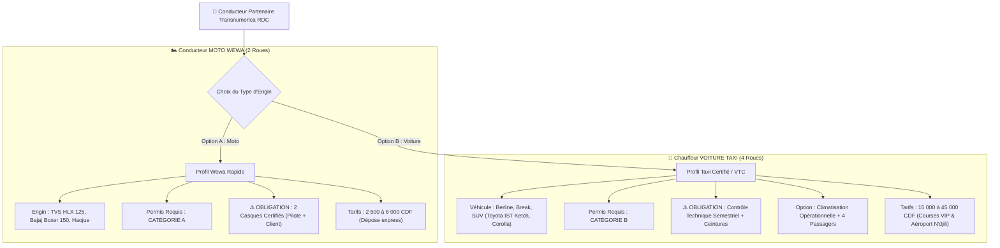
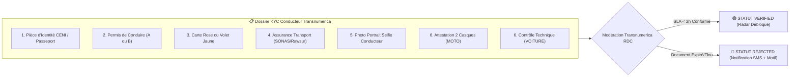
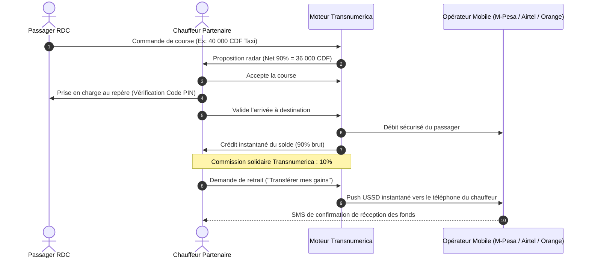

# 🚖 Guide Officiel du Processus Conducteur (Voiture & Moto Wewa) — Transnumerica RDC

Ce document détaille l'intégralité du processus d'inscription (**Sign Up**), de connexion (**Login**), de certification réglementaire (**KYC**) et d'exploitation du tableau de bord pour les **Chauffeurs de Voiture (Taxis/VTC)** et les **Conducteurs de Motocyclette (Wewa)** sur la plateforme **Transnumerica** en République Démocratique du Congo.

---

## 🎯 1. Vue d'Ensemble & Modèle Économique

Transnumerica est la plateforme unifiée de mobilité et de billetterie en RD Congo (Kinshasa, Lubumbashi, Kolwezi, Matadi, Goma). 

### Principes Clés pour les Conducteurs Partenaires :
1. **Commission Solidaire de 10% Seulement** : Alors que les applications internationales (Yango, Uber) prélèvent entre 20% et 25%, Transnumerica reverse **90% net des gains** au conducteur.
2. **Paiements Mobile Money Instantanés** : Gains virés directement sur le portefeuille téléphonique du conducteur (Vodacom M-Pesa, Airtel Money, Orange Money, Africell Money) dès la fin de course sans frais de retrait cachés.
3. **Application Ultra-Légère (PWA)** : Optimisée pour les réseaux 2G/3G/4G congolais avec mode économiseur de données (-85% de data consommée) et mode nuit anti-éblouissement.
4. **Cockpit Confiné & Sans Distraction** : L'espace `/driver` est totalement isolé de l'application passager. Le conducteur dispose d'un poste de pilotage dédié et ne risque pas de quitter sa session en conduisant.

---

## 🏗️ 2. Différenciation : Moto (Wewa) vs Voiture (Taxi / VTC)

Transnumerica sépare clairement les deux modes de transport urbain en RDC afin d'adapter les tarifs, les algorithmes de matching, les délais d'approche (ETA) et les exigences légales :

### Tableau Comparatif Exhaustif

| Critère de Différenciation | 🏍️ Mototaxi Wewa (2 Roues) | 🚗 Voiture Taxi / VTC (4 Roues) |
| :--- | :--- | :--- |
| **Profil & Image de Marque** | « Wewa Rapide » • Trajets rapides anti-embouteillages | « Taxi Certifié » • Trajets privés, confort & sécurité |
| **Capacité Passagers** | **1 Passager uniquement** | **Jusqu'à 4 Passagers** (avec coffre pour bagages) |
| **Permis de Conduire Obligatoire** | **Permis Catégorie A** (Deux-roues motorisés) | **Permis Catégorie B** (Véhicules légers de transport) |
| **Équipement de Sécurité Clé** | **2 Casques de protection obligatoires** (conducteur + passager avec charlotte) | **Ceintures de sécurité fonctionnelles** à toutes les places |
| **Contrôle & Inspection** | Attestation de bon état mécanique et freins | **Certificat de Contrôle Technique Automobile périodique** valide |
| **Confort Climatique** | Veste haute visibilité + imperméable intempéries | **Climatisation opérationnelle** (débloque les courses d'affaires) |
| **Documents de Propriété** | **Volet Jaune** ou Carte Rose Motocyclette | **Carte Rose Automobile** officielle |
| **Fourchette Tarifaire RDC** | 2 500 FC à 6 000 FC par course | 15 000 FC à 45 000 FC (centre-ville, N'djili, gares) |
| **Coopératives Rattachées** | COWEMOTO, Coopératives Wewa communales | Association des Taxis Jaunes, Taxis Indépendants |

---

## 📱 3. Processus d'Inscription (Sign Up) Pas-à-Pas

L'inscription s'effectue en moins de 3 minutes depuis un smartphone Android ou iPhone connecté à Internet :

### Étape 1 : Accès & Choix de la Catégorie
1. Le conducteur se rend sur `https://transnumerica.cd/driver` ou clique sur **« Mode Chauffeur Partenaire »** depuis le menu bas du site public.
2. Il clique sur **« Créer un Compte Conducteur »** dans la fenêtre d'authentification.
3. Il renseigne :
   - **Nom et Prénom officiels** (tels qu'inscrits sur le permis de conduire et la carte d'électeur CENI).
   - **Numéro de téléphone Mobile Money RDC** (ex: `081 234 5678` pour Vodacom M-Pesa, `097 123 4567` pour Airtel Money, `089 987 6543` pour Orange Money, ou `090 123 4567` pour Africell). L'opérateur est détecté automatiquement par le système.
   - **Ville principale d'activité** (Kinshasa, Lubumbashi, Kolwezi, Matadi, Goma).

### Étape 2 : Vérification du Numéro par Code OTP
1. Le conducteur reçoit un **code SMS de sécurité à 6 chiffres** (ou via WhatsApp en cas de lenteur réseau de l'opérateur).
2. L'application mobile lit automatiquement le SMS via l'API WebOTP ou le conducteur saisit les 6 chiffres.
3. L'identité téléphonique du conducteur est vérifiée et liée de manière unique à son identifiant financier.

### Étape 3 : Spécifications du Véhicule (Moto ou Voiture)
1. **Choix du type d'engin** :
   - 🏍️ **Moto Wewa** : Choix du modèle (ex: TVS HLX 125 Plus, Bajaj Boxer 150), saisie de la plaque d'immatriculation (ex: `KN 1192 MT`) et engagement obligatoire à fournir un 2ème casque au client.
   - 🚗 **Voiture Taxi** : Choix du modèle (ex: Toyota IST Ketch, Toyota Corolla RunX), saisie de la plaque (ex: `KN 8291 BG`), déclaration de la climatisation et capacité de bagages.
2. **Affiliation éventuelle à une coopérative** (facultatif mais recommandé pour accélérer l'agrément).

### Étape 4 : Redirection vers le Cockpit avec Statut `PENDING`
- Le compte conducteur est créé avec succès.
- Le statut initial est **`PENDING` (En attente de pièces)**.
- **Le radar reste verrouillé** : le conducteur ne peut pas prendre de passagers tant que ses documents KYC n'ont pas été soumis et validés.

---

## 🔑 4. Processus de Connexion (Login)

Pour un conducteur déjà inscrit :
1. Accéder à `https://transnumerica.cd/driver`.
2. Saisir son numéro de téléphone habituel.
3. Valider le code OTP à 6 chiffres reçu par SMS ou WhatsApp.
4. Le cockpit charge immédiatement :
   - L'historique des gains du jour et de la semaine.
   - Le statut de conformité KYC en direct (**VERIFIED**, **PENDING**, ou **REJECTED**).
   - Les réglages de conduite nocturne et d'économiseur de données.
   - Le bouton radar (En Ligne / Hors Ligne).

---

## 🛡️ 5. Le Dossier Réglementaire KYC (Know Your Customer)

Conformément à la législation de la République Démocratique du Congo régissant le transport public rémunéré de personnes, aucun conducteur ne peut circuler sous la bannière Transnumerica sans agrément préalable.

### Checklist des Documents Exigés dans l'Onglet « KYC » :

1. **Pièce d'Identité Officielle** :
   - Carte d'électeur délivrée par la CENI ou Passeport biométrique congolais en cours de validité.
2. **Permis de Conduire National** :
   - Catégorie **A** pour les motocyclistes Wewa.
   - Catégorie **B** pour les conducteurs de véhicules de tourisme / taxis.
3. **Titre de Circulation de l'Engin** :
   - Volet jaune d'enregistrement pour motocyclette.
   - Carte rose officielle délivrée par la Direction Générale des Impôts (DGI) pour automobile.
4. **Police d'Assurance Automobile / Mototaxi** :
   - Attestation d'assurance responsabilité civile valide (SONAS, Rawsur Assurances, Activa RDC, etc.).
5. **Preuve de Sécurité Spécifique** :
   - **Pour les Motos** : Attestation photographique prouvant la possession de **2 casques intégraux ou semi-intégraux en bon état**.
   - **Pour les Voitures** : Certificat de **Contrôle Technique Périodique Automobile** délivré par un centre agréé (CNPR).
6. **Photo Portrait Selfie** :
   - Photo nette de face, sans lunettes de soleil, sur fond neutre. Cette photo est affichée aux passagers pour identification lors de la prise en charge.

### Procédure de Téléversement :
1. Dans le cockpit, cliquer sur l'onglet **« KYC »**.
2. Cliquer sur **« Ajouter une pièce »**.
3. Sélectionner le type de document, saisir le numéro officiel, les dates de délivrance et d'expiration, et charger la photo nette recto/verso (JPG, PNG ou PDF, max 10 Mo).
4. Le document passe en revue avec un délai de traitement moyen inférieur à **2 heures ouvrées**.

---

## 🔒 6. Règles de Confinement du Tableau de Bord Chauffeur

L'architecture du cockpit conducteur respecte une règle stricte de **confinement d'espace** :

1. **Aucun Lien Passager Fuyant** :
   - Sur `/driver`, les liens vers la réservation d'autocars interurbains, la livraison ou les hôtels sont volontairement supprimés.
   - Le conducteur reste concentré sur sa mission de transport et la sécurité de sa conduite.
2. **Structure des 4 Onglets Internes** :
   - **Onglet Radar** : Gestion des courses en direct (acceptation, négociation par contre-offre, code PIN sécurisé et validation de paiement).
   - **Onglet KYC** : Jauge de complétude en pourcentage et état de validation de chaque pièce administrative.
   - **Onglet Véhicule** : Bascule instantanée entre profil Moto et profil Voiture, spécifications de plaque et déclarations de sécurité.
   - **Onglet Gains** : Bilan financier transparent (gains bruts, déduction des 10%, gains nets et demande de retrait instantanée).
3. **Bascule vers le Mode Passager** :
   - Si le conducteur souhaite réserver un bus pour lui-même ou commander une course en tant que client, il clique sur le bouton **« Passager »** dans l'en-tête, ce qui le redirige vers l'accueil public (`/`).

---

## 💰 7. Flux Financier & Retraits Mobile Money

Transnumerica applique le principe de transparence financière totale :

1. **Course de 10 000 CDF** ➔ Le chauffeur perçoit **9 000 CDF nets**.
2. **Course de 4 000 CDF Wewa** ➔ Le motocycliste perçoit **3 600 CDF nets**.
3. **Retrait Instantané** : Le solde disponible peut être viré en un clic vers le numéro Vodacom, Airtel, Orange ou Africell du chauffeur.

---

## ❓ 8. Guide de Dépannage & FAQ Chauffeur

### Q1 : Que faire si je ne reçois pas le code SMS OTP lors de la connexion ?
- Attendez 45 secondes que le décompte prenne fin.
- Cliquez sur **« Renvoyer par WhatsApp »** : le code sera immédiatement acheminé via les serveurs WhatsApp Business de Transnumerica.

### Q2 : Pourquoi le bouton « Passer EN LIGNE » refuse-t-il de s'activer ?
- Votre dossier KYC est incomplet ou en cours de vérification. Rendez-vous dans l'onglet **KYC** pour vérifier si une pièce (permis, carte rose, assurance) a été rejetée ou si elle est en attente d'approbation.

### Q3 : Puis-je conduire à la fois une Moto et une Voiture avec le même compte ?
- **OUI.** Transnumerica permet le multicompte véhicule. Cliquez sur le badge véhicule dans l'en-tête pour basculer de **Mode Moto Wewa** à **Mode Voiture Taxi**. Le radar ajustera automatiquement les propositions de courses reçues.

### Q4 : Que se passe-t-il si un document (assurance ou contrôle technique) arrive à expiration ?
- Le système vous adresse une notification 30 jours, 15 jours et 3 jours avant la date limite.
- Si le document n'est pas renouvelé le jour J, le radar est suspendu automatiquement par mesure de conformité réglementaire jusqu'à soumission de la nouvelle vignette.

---

*Document de référence interne et opérationnel — Transnumerica République Démocratique du Congo.*

